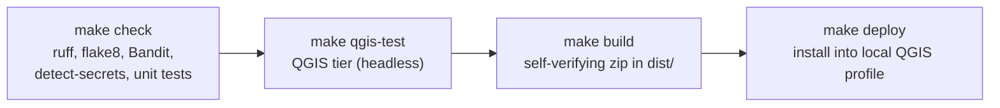

# DocQGISProject

A QGIS 4 plugin that documents a QGIS project for two audiences from one run:

- **People:** Markdown, HTML and PDF reports, readable enough to rebuild the project by hand, with
  rendered layout pages, symbols and legends.
- **Machines:** a schema-versioned JSON file complete enough to rebuild the project programmatically.

**Status: development (phase P6 of 7).** Everything in the design works; the release work (P7) remains.

What one run writes:

- `project.json`: everything about the project, plus a lossless rebuild payload (the project file
  with credentials removed and data sources listed separately). Described by
  [`docs/schema/docqgisproject-1.schema.json`](docs/schema/docqgisproject-1.schema.json).
- `report.md`, `report.html` (one self-contained page, no JavaScript) and `report.pdf`: project
  settings, layer tree, layers and sources, fields, joins, relations, variables, map themes,
  bookmarks, full styling and labels, print layouts with every item, fonts and files, warnings,
  how much of the project file the report explains, and how to rebuild.
- Images (`images/`, `layouts/`), one QML style per layer (`styles/`) and one template per layout
  (`layouts/*.qpt`). Optionally, screenshots of the QGIS dialogs.

## Using it

**Dialog:** *Project > Document Project...* Choose the open project or a project file, an output
folder, formats and options, then *Document*. Progress, *Cancel run* and *Open report* are in the
dialog; every option has a tooltip and is remembered. Dialog screenshots (off by default) are only
available here, only for the open project: each QGIS dialog opens briefly and closes with Cancel,
pages that show data sources or logins are skipped, and fields with paths or addresses are blacked out.

**Processing:** *Processing Toolbox > Documentation*: *Document project* and *Rebuild project from
JSON*. Also usable from models, batch mode and `qgis_process`.

**Python console:**

```python
from DocQGISProject.core.runner import document_project
from DocQGISProject.core.options import DocOptions
from DocQGISProject.core.rebuild import rebuild_project

# The open project, or a path to a .qgz/.qgs file (read without touching the open project).
result = document_project(QgsProject.instance(), "/path/to/output_folder", DocOptions())

# A new project from the JSON; map moved data folders and attach logins by source id.
rebuild_project(
    "/path/to/output_folder/project.json",
    "/path/to/new.qgz",
    source_map={"/old/data": "/new/data"},
    auth_map={"s3": "ab12cd3"},
)
```

Options: `formats` (json, markdown, html, pdf; default all), `detail` (summary, standard, full),
`images` and `image_dpi` (default on, 120), `embed_resources` (SVG and images in the JSON; default
on), `load_data` (open local data for counts and extents; default on), `redact` (default on),
`include_network_layers` (default off: web services and databases are never contacted), `overwrite`
(default off: files this plugin did not write are never replaced), `screenshots` and
`screenshot_layers` (dialog only).

The rebuilder treats the JSON as untrusted: it checks it in full first, removes macros and other
Python code, refuses absolute data paths you have not mapped, and never overwrites a file.

Requirements: QGIS 4.0 or later (Qt 6). Licence: GPL-2.0-or-later.

## Development



| Command | What it does |
|---|---|
| `make check` | All gates: `ruff check`, `flake8` (authoritative), `bandit`, `detect-secrets`, unit tests (`tests/unit`, pure Python) |
| `make qgis-test` | QGIS integration tier (`tests/qgis`) under QGIS's own Python, offscreen; gated by `DOCQGISPROJECT_QGIS_TEST=1` |
| `make fixtures` | Generate the synthetic test projects into `tests/fixtures/generated/` (git-ignored) |
| `make build` | Build `dist/DocQGISProject.zip` from `plugin_build.conf` and verify its contents |
| `make deploy` | Build and install into the local QGIS 4 profile (restart QGIS afterwards) |

Tools: [uv](https://docs.astral.sh/uv/) runs the linters in throwaway environments. On Ubuntu the QGIS tier
uses the system Python (`/usr/bin/python3`) with `PATH=/usr/bin:/bin`, because a different Python first on
`PATH` breaks PyQt6.

Reproduce the QGIS tier by hand:

```bash
DOCQGISPROJECT_QGIS_TEST=1 PATH=/usr/bin:/bin QT_QPA_PLATFORM=offscreen \
    /usr/bin/python3 -m pytest tests/qgis -q -p no:cacheprovider
```

## Security

The plugin is read only: it never modifies the project or its data and never runs project macros,
actions or embedded Python. Credentials in data sources are redacted from every output by default.
See section 9 of the design.
