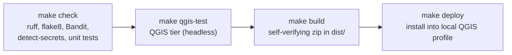

# DocQGISProject

A QGIS 4 plugin that documents a QGIS project for two audiences from one run:

- **People:** Markdown, HTML and PDF reports, readable enough to rebuild the project by hand, with
  rendered layout pages, symbols and legends.
- **Machines:** a schema-versioned JSON file complete enough to rebuild the project programmatically.

**Status: development (phase P0, scaffold).** The plugin installs, adds *Project > Document Project...*
and registers an empty Processing provider ("Documentation"). It does not produce documentation yet.
See [`docs/DESIGN.md`](docs/DESIGN.md) for the design and delivery plan.

Requirements: QGIS 4.0 or later (Qt 6). Licence: GPL-2.0-or-later.

## Development



| Command | What it does |
|---|---|
| `make check` | All gates: `ruff check`, `flake8` (authoritative), `bandit`, `detect-secrets`, unit tests (`tests/unit`, pure Python) |
| `make qgis-test` | QGIS integration tier (`tests/qgis`) under QGIS's own Python, offscreen; gated by `DOCQGISPROJECT_QGIS_TEST=1` |
| `make fixtures` | Generate the synthetic test projects into `tests/fixtures/generated/` (git-ignored) |
| `make build` | Build `dist/DocQGISProject.zip` from `plugin_build.conf` and verify its contents |
| `make deploy` | Build and install into the local QGIS 4 profile (restart QGIS afterwards) |

Tools: [uv](https://docs.astral.sh/uv/) runs the linters in throwaway environments. On Ubuntu the QGIS tier
uses the system Python (`/usr/bin/python3`) with `PATH=/usr/bin:/bin`, because a different Python first on
`PATH` breaks PyQt6.

Reproduce the QGIS tier by hand:

```bash
DOCQGISPROJECT_QGIS_TEST=1 PATH=/usr/bin:/bin QT_QPA_PLATFORM=offscreen \
    /usr/bin/python3 -m pytest tests/qgis -q -p no:cacheprovider
```

## Security

The plugin is read only: it never modifies the project or its data and never runs project macros,
actions or embedded Python. Credentials in data sources are redacted from every output by default.
See section 9 of the design.
