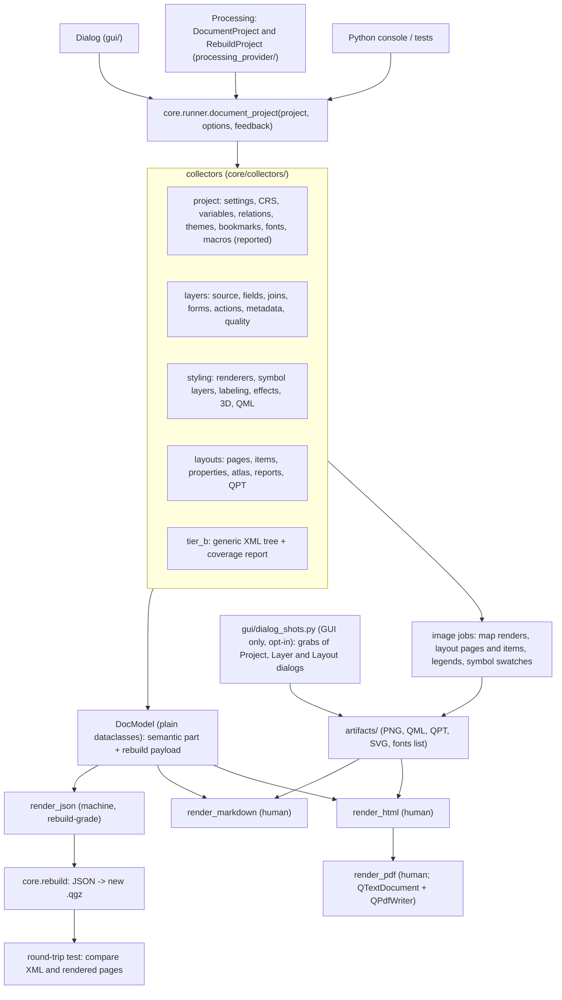

# DocQGISProject: design

Status: DRAFT 2 for owner sign-off (2026-11-11), revised after the owner added R7 to R9. No plugin code exists yet.

## 1. Purpose

Produce documentation of a QGIS project for two audiences from one run. People get Markdown, HTML and PDF reports they can read
and follow to rebuild the project by hand, with the visual outputs (maps, print layouts, figures, symbols, labels, legends)
documented most completely and illustrated with screenshots of the real QGIS dialogs. Machines get a JSON file that is complete
enough to rebuild the project programmatically.

Why it is needed: a project file (`.qgz`/`.qgs`) is XML nobody reads, the Layer Properties dialogs hide the settings across
dozens of tabs, and there is no built-in way to hand a colleague (or your future self) a statement of what was done and with
which parameters. Origin: the Wildlands trail-map recreation (a 1000-line builder script was needed to document one map).

## 2. Requirements (from the owner, 2026-11-11)

| # | Requirement |
|---|---|
| R1 | Outputs: HTML report, Markdown, PDF, JSON |
| R7 | The human outputs (HTML, Markdown, PDF) must be readable by people; the JSON is for machines and must be usable to rebuild a project |
| R8 | Include screenshots of QGIS dialogs where possible |
| R2 | Capture layers and data sources; styling; layouts and project settings; metadata and quality |
| R3 | Capture all elements of a project file so a human could rebuild the project; every aspect of visual outputs (maps, layouts, figures, objects) is critical |
| R4 | Interface: a dialog plus a Processing algorithm (same engine) |
| R5 | QGIS 4.x only (Qt 6 / PyQt6); licence GPL-2.0-or-later |
| R6 | Public repository `johnzastrow/DocQGISProject` |
| R9 | (derived from R3 and R7) a rebuild from the JSON must be verified by a round-trip test, not assumed |

Non-goals for 0.x: editing or repairing existing projects (the rebuilder only creates a new project file); copying the user's
data (the report records where the data are and how to get them; a data package is out of scope); documenting plugin-specific
data stored outside the project; QGIS 3.x; word-processor formats (.docx).

## 3. Principles

1. Read only. The plugin never modifies the project, layers or data, and never executes project content (macros, actions,
   expressions with side effects, Python in forms). Macros are reported, not run.
2. Two audiences, two formats. Prose, tables, pictures and step-by-step guidance for people (section 6b); lossless, schema-validated
   data for machines (section 8). A person never has to read JSON and a machine never has to parse prose.
3. Completeness is measurable. Two tiers (section 5) plus a coverage report that lists every project XML element that no
   collector explained, so "complete" is a number, not a hope.
4. One model, many renderers. Collectors fill a plain-data model; the four renderers only read it. No renderer calls the QGIS API.
5. Core is UI-free. The same engine runs from the dialog, from Processing, from the Python console and headless in tests.
6. Safe by default: secrets redacted, all text HTML-escaped, nothing fetched from the network, files written only under the
   output folder the user chose.
7. Nothing silently missing: a collector that fails records the failure in the output (the section shows "could not be read: reason").

## 4. Architecture



Layout of the repository (flat plugin layout, as the build tooling expects):

```
DocQGISProject/                 repo root = plugin root
  __init__.py                   classFactory
  metadata.txt                  qgisMinimumVersion=4.0, supportsQt6=True, version 0.1.0
  docqgisproject.py             plugin class (menu, toolbar, provider registration)
  core/                         NO UI imports
    runner.py  model.py  options.py  redact.py  safe_paths.py  xmlwalk.py  rebuild.py  schema.py
    collectors/  project.py layers.py styling.py layouts.py metadata.py tier_b.py
    images.py                   rendering jobs (map, layout, legend, symbol)
  render/       json_out.py  md_out.py  html_out.py  pdf_out.py  templates/  strings.py (QGIS UI names)
  gui/          dialog.py  dialog_shots.py  (Qt Designer .ui)
  processing_provider/  provider.py  document_project_algorithm.py
  icons/  i18n/
  tests/        unit (pure Python) + qgis (headless, env-gated) + fixtures/
  docs/         DESIGN.md  CHANGELOG at root
  scripts/ plugin_build.conf Makefile  (from the qgis-plugin skill templates)
```

## 5. Completeness strategy (R3)

Tier A (semantic): purpose-built collectors that explain each known object in prose and tables. Tier B (generic): a walk of the
project XML that renders every element and attribute not claimed by Tier A as a collapsible tree in an appendix, with the raw
layer styles (QML) and layouts (QPT) saved as files. A claim is made by recording the XML path a collector consumed. The
**coverage report** lists unclaimed paths grouped by top-level element. Acceptance target: every element in the test projects is
either claimed or appears in Tier B; unclaimed Tier A gaps are tracked as issues.

What "rebuild" means: (a) a person can recreate the project by following the report (section 6b); (b) a program can recreate it from
the JSON (section 8). Both are tested: (a) by the readability review gate, (b) by the round-trip test.

### Catalogue (what Tier A explains)

| Area | Content |
|---|---|
| Project | title, file, version written, CRS and ellipsoid, transform context, units, extent, variables, relations, map themes, bookmarks, default styles, snapping, topological editing, trust and macro presence, server (WMS/WFS) settings, custom properties, plugins referenced |
| Layer tree | groups, order, visibility, expanded state, mutually exclusive groups, per-layer legend names, layer-tree embedding |
| Layers | type, provider, redacted source, CRS, extent, feature count, fields (name, type, alias, default, constraints, widget), joins, virtual fields, filters (subset strings), scale visibility, opacity, blend, notes, edit forms, actions, temporal and elevation properties, vector-tile / raster resampling, pyramids |
| Styling | renderer per layer (single, categorized, graduated, rule-based, 25D, heatmap, point cluster, ...), every symbol and every symbol layer with all properties, data-defined overrides (expressions shown), labeling (every setting, rules, masks, obstacles, callouts), diagrams, effects, blend modes, raster renderers and colour ramps, QML export |
| Layouts | page setup, every item (type, id, position and size in mm, reference point, rotation, frame, background, blend, data-defined properties), map items (extent, scale, layers, theme, grids, overviews, labels), legends (nodes, filters, styles), scale bars, pictures (source, resize mode), labels (text), tables, HTML and attribute tables, atlas settings, reports, rendered preview image per page and per item, QPT export |
| Resources | fonts used (families and styles, found on the system or not), SVG and image paths (embedded or external), resolvable or missing |
| Quality | broken layer links, missing CRS, layers without metadata, fonts not installed, external paths, absolute vs relative paths, duplicate names, large unfiltered layers |
| Metadata | layer and project metadata (title, abstract, keywords, contacts, rights, links) as written in the project |

## 6. Visual outputs (the critical part)

Every picture is rendered by QGIS itself, headless-capable, and saved to `artifacts/` with a stable name and recorded in the model:

- each layout page at a chosen DPI (`QgsLayoutExporter.renderPageToImage`), plus each map, legend and scale-bar item cropped
  at higher DPI so details are readable;
- each layer's legend swatches and each symbol (`QgsSymbol.asImage`, `QgsLayerTreeModel` legend nodes);
- an overview map of the project canvas extent and, optionally, each map theme;
- per-layer thumbnails with the layer alone.

Rendering rules: user-set DPI and maximum pixel budget; progress and cancel through `QgsFeedback`; a render that fails records a
note and the report continues; never render with network layers unless the user opted in (a slow or unavailable web layer must
not hang a report).

## 6b. Human-readable outputs and dialog screenshots (R7, R8)

Readability rules, enforced by templates and a lint test:

1. Order follows how a person builds a project: overview, then "How to recreate this project" (numbered steps: create the project
   and set its CRS; add each layer in tree order with its source; style it; arrange the layer tree; build each layout), then the
   detail chapters, then appendices. The detail chapters mirror QGIS's own structure and wording (the plugin carries a table of
   QGIS UI names, e.g. "Layer Properties > Symbology > Single Symbol > Fill colour"), so every setting has a "Where in QGIS" cell.
2. Each setting is a row in a small table (Setting | Value | Where in QGIS), values formatted for people (colours as swatch plus
   hex and RGB, sizes with units, expressions in code blocks with a plain-language note, booleans as Yes/No), never raw property
   dicts. Defaults are collapsed or omitted so the differences from QGIS's defaults stand out ("only what you changed").
3. Every picture has a caption and alt text. Layout pages come first, then item close-ups, then symbol and legend swatches.
4. Each chapter starts with a one-paragraph summary and ends with warnings (missing data, absent fonts, external paths).
5. Raw Tier B trees, QML and QPT are appendices and downloadable files, never in the main flow.
6. HTML has a table of contents, collapsible sections, print CSS; Markdown is clean enough to read as plain text; the PDF has page
   numbers, running headers, no clipped tables (column widths set per table type).
7. A readability lint in the test suite: no table wider than 6 columns, no heading deeper than 4, no raw `{...}` dicts or Python repr
   in the body, every image has alt text, reading-level and length reported per chapter. A human review of a real report is a
   release gate (section 11).

Screenshots of QGIS dialogs (best-effort, GUI sessions only, opt-in):

- A grab of the real dialog widget, not a desktop screenshot (`QWidget.grab()`), so nothing outside QGIS is captured: Project
  Properties (each page), Layer Properties (each tab of each documented layer, or a chosen subset), the Layout Designer item
  properties panels, Layout Manager, Data Source Manager where useful.
- Opened through the QGIS interface (`iface.showProjectPropertiesDialog`, `iface.showLayerProperties`, the layout designer
  interface), stepped through the pages, grabbed, then closed with reject so nothing is applied or changed.
- Not available in Processing or headless runs: the report then says so and shows the generated tables and swatches instead.
  Screenshots never replace the tables; they accompany them ("Where in QGIS" cell links to the grab).
- Privacy: dialogs show raw sources and credentials. Source and authentication pages are skipped by default; any grab of a page
  with a path or URI is blurred in the image over the known widgets or skipped; the dialog states what was skipped. A screenshot is
  opt-in because it opens many dialogs and takes time (budget: layer properties for N layers x tabs; progress and cancel).
- Risks to manage: dialog opening is slow and platform-dependent; look differs with theme, scale factor and language (recorded in
  the report: QGIS version, theme, OS, locale); layout item panels need the item selected in the designer (fragile across QGIS
  versions, so tested per release and allowed to fail with a note).

## 7. Interfaces (R4)

Processing algorithm `docqgisproject:documentproject`:

| Parameter | Type | Default |
|---|---|---|
| INPUT | project file (.qgz/.qgs) or "current project" | current |
| OUTPUT_FOLDER | folder | required |
| FORMATS | multiple choice: json, markdown, html, pdf | all |
| DETAIL | enum: summary, standard, full (full includes Tier B and every item) | standard |
| IMAGES | boolean | true |
| IMAGE_DPI | integer | 120 |
| SCREENSHOTS | enum: none, project, layers, all (GUI only; ignored in headless runs with a note) | none |
| EMBED_RESOURCES | boolean: put SVG and small images used by styles and layouts inside the JSON (fonts are listed, never embedded: licences) | true |
| LOAD_DATA | boolean: resolve layers for counts and extents (off = document from XML only, fast, works offline) | true |
| REDACT | boolean: remove credentials from sources | true |
| INCLUDE_NETWORK_LAYERS | boolean | false |
| Outputs | one output per written file plus a summary dict | |

A second algorithm `docqgisproject:rebuildproject` takes a JSON file and an output `.qgz`, and writes a new project (section 8). It
has its own safety rules: JSON is untrusted input, macros stay disabled and the project is marked untrusted, relative paths only
unless the user maps them, an existing file is never overwritten.

The dialog is the same parameters with a project picker, a progress bar, Cancel, "Open report" and a preview of the coverage
figure. Running on a file opens it in a separate `QgsProject` object, never the live instance.

## 8. Output formats (R1)

- JSON (machine, rebuild-grade): schema-versioned (`"schema": "docqgisproject/1"`, JSON Schema in `docs/schema/`). Two parts:
  `semantic` (structured, queryable: layers, fields, symbols, layout items with typed values, for tools that want to analyse a
  project) and `rebuild` (the lossless payload: the project XML with sources parameterised, every layer's QML, every layout's QPT,
  embedded SVG/images, map themes, relations, a resource manifest with SHA-256 for external files, and a `sources` table that
  separates the data location from the secret so a rebuilder can supply its own paths and credentials). Redacted values are
  explicit placeholders (`{"redacted": "password"}`), never silently dropped. Data themselves are not included (non-goal);
  the manifest records path, provider, size and hash so the rebuilder can check what it finds.
- As built (P5): the project XML is the whole lossless payload. It already contains every layer's style and every
  layout, so QML and QPT are not repeated inside the JSON (they are still written as files beside the report).
- `core.rebuild` reads the JSON, validates it against the schema, maps sources (`--map-source old=new`), creates a new
  `QgsProject`, loads layers, applies QML, restores the layer tree, themes, relations and layouts from QPT, and writes the `.qgz`.
- Round-trip test (R9): fixture project A -> JSON -> rebuilt project B; B's normalised XML must equal A's apart from an allow-list
  (timestamps, ids, absolute paths), and every layout page of B must render within a pixel tolerance of A's. The Wildlands print
  project is run through it manually as the hard case.
- Markdown (human): GitHub-flavoured, one `report.md` plus `images/`; headings and tables only, diff-friendly, suits notes and wikis.
- HTML (human): one self-contained file (images as data URIs under a size cap, otherwise linked) with a table of contents, collapsible
  sections, no JavaScript beyond `<details>`, strict CSP `<meta>`.
- PDF (human): rendered from a simplified HTML with `QTextDocument` and `QPdfWriter` (QtWebEngine is not available in QGIS builds); tables and
  images, page headers and numbering; no external fonts.

## 9. Security and privacy profile (production, public plugin)

Assumptions to confirm: no network access by the plugin; no authentication of its own; data classification of what it documents
varies (a project can reveal internal paths, hostnames and credentials); no compliance regime; target distribution
plugins.qgis.org plus GitHub releases.

| Risk | Control |
|---|---|
| Credentials in data source URIs (`password=`, `user=`, tokens, API keys in WMS/XYZ URLs, auth config ids) | `core.redact` runs on every URI and custom property with provider-aware decoding (`QgsProviderRegistry.decodeUri`, `QgsDataSourceUri.uri(False)`) plus a conservative regex for key-like parameters; on by default; redactions are counted in the report; unit tests with a corpus of URIs |
| XSS and injection in reports from project text (layer names, notes, expressions) | all strings escaped on output, templates auto-escape, Markdown escapes control characters; a hostile-project fixture is a test |
| Path traversal and overwrite when writing artifacts | `core.safe_paths`: output only inside the chosen folder, sanitised file names, never follows symlinks out, refuses to overwrite non-plugin files unless the user chose "overwrite" |
| Executing project content | never; macros, actions and Python snippets are shown as inert text with a warning |
| Network side effects while loading or rendering | network layers skipped by default; no telemetry; no external requests from the HTML report (no remote fonts, scripts or images) |
| Denial of service on huge projects | feedback and cancel everywhere; image pixel budget; per-layer timeouts for counts; `LOAD_DATA` off for a fast path |
| Screenshots leaking secrets or private paths | opt-in; source and authentication pages skipped or blurred; widget grabs only (no desktop capture); report states what was skipped |
| Malicious JSON given to the rebuilder (untrusted input) | schema validation first; no code execution (macros disabled, project untrusted); no absolute paths outside a user-mapped root; size limits; never overwrites; embedded resources written only under the output folder with sanitised names |
| Packaging gates (plugins.qgis.org) | Bandit, detect-secrets, flake8 in CI; no `*.sh` in the zip; no bundled binaries; pure Python standard library plus QGIS (no third-party dependencies) |

## 10. Testing

- Unit (pure Python, no QGIS): redaction corpus, safe paths, model to JSON, Markdown and HTML renderers on golden files, XML walker.
- QGIS integration (headless, `DOCQGISPROJECT_QGIS_TEST=1`, offscreen): small synthetic projects generated by a script
  (every renderer type, labeling rules, a layout with each item type, atlas, relations, themes), run the whole pipeline, assert
  the JSON against expectations and that every artifact exists; crash tests per the skill's pitfalls (selection and signals in the
  dialog, categorized renderers).
- Round trip (R9): fixture -> JSON -> rebuild -> compare XML and rendered pages; plus a negative test corpus of hostile JSON.
- Readability lint (section 6b) on the generated reports; golden files for the human formats.
- Coverage test: for each fixture, unclaimed XML paths must equal an explicit allow-list that shrinks over time.
- Manual acceptance on real projects, including the Wildlands print project (kept outside this repo).
- Click test in a real QGIS 4 for the dialog before every release.

## 11. Delivery plan

```mermaid
flowchart LR
    P0["P0 scaffold, CI, fixtures"] --> P1["P1 model + project, layers, sources, redaction<br/>JSON + Markdown"]
    P1 --> P2["P2 styling collectors, QML, symbol and legend images"]
    P2 --> P3["P3 layouts: every item, page and item images, QPT"]
    P3 --> P4["P4 HTML + PDF, readability lint, Tier B, coverage report"]
    P4 --> P5["P5 rebuild payload + rebuilder + round-trip test"]
    P5 --> P6["P6 Processing algorithms + dialog, progress and cancel, dialog screenshots"]
    P6 --> P7["P7 hardening, docs, human review, release 0.1.0"]
```



| Phase | Done when |
|---|---|
| P0 | repo builds a plugin zip that installs and loads in QGIS 4 and shows a menu entry; CI runs ruff, flake8, Bandit, detect-secrets and the unit tests; fixtures generator exists |
| P1 | `document_project()` on a fixture writes JSON and Markdown with project, tree, layers, sources (redacted), fields, relations, variables, themes |
| P2 | every renderer and symbol layer type in the fixtures appears with all properties; QML saved; legend and symbol images saved |
| P3 | every layout item type in the fixtures documented with position and size and rendered; page and item images; QPT saved; atlas and report documented |
| P4 | HTML and PDF produced from the same model; readability lint passes; Tier B appendix and coverage report; hostile-project test passes |
| P5 | JSON validates against the schema; `rebuild` recreates fixture projects; round-trip test passes on all fixtures; hostile-JSON corpus rejected |
| P6 | both algorithms run headless (`qgis_process`) and from the dialog; cancel works; screenshots of project, layer and layout dialogs captured in a GUI session, with skipped pages reported |
| P7 | gates green, a person who did not write the plugin rebuilds a sample project from the report alone (review gate), README with screenshots, CHANGELOG, tagged release, zip uploaded to plugins.qgis.org |

## 12. Open questions (with recommended defaults)

| # | Question | Recommendation |
|---|---|---|
| Q1 | HTML images: embed as data URIs, or link to `images/`? | embed up to 8 MB total, otherwise link; Markdown always links |
| Q2 | Redaction default | on, with a visible banner when off |
| Q3 | Ship the rebuilder (JSON to project) in 0.1, or only the rebuild-grade JSON and a test-only rebuilder? | ship it: an unverified "rebuildable" claim is worth nothing; the algorithm is small once the payload exists |
| Q4 | Plugin menu location | Project menu entry and a Processing provider "Documentation" |
| Q5 | Report language | English only for 0.x; strings wrapped for translation from the start |
| Q6 | Name of the package/zip folder | `DocQGISProject` (matches the repo and the owner's wording) |
| Q8 | Screenshot scope by default | `none`; when on, project dialogs plus the layers the user selects; all tabs, minus source and authentication pages |
| Q9 | Should the JSON ever hold unredacted credentials? | no; the rebuilder takes credentials from QGIS authentication configurations or the user at rebuild time |
| Q10 | Embed SVG and images in the JSON | yes under a size cap per file and in total (default 20 MB); fonts only listed |
| Q7 | Use the sibling `metadatamgr` plugin's database for the metadata section? | no; read only what is in the project file; link to metadatamgr in the README |
