# Handoff: DocQGISProject (design stage), 2026-11-11

Read this first after a restart. Then read `docs/DESIGN.md` (draft 2).

## State

- Repo: https://github.com/johnzastrow/DocQGISProject (public, GitHub account `johnzastrow`), local `~/Github/DocQGISProject`, branch `main`.
- Contents: stub `README.md`, `.gitignore`, `docs/DESIGN.md` (draft 2), this file. **No plugin code yet. No licence file yet. Nothing released.**
- The owner has NOT yet signed off on draft 2. Three decisions are open (the defaults below are my recommendations, not approvals):
  1. Ship the rebuilder (JSON to new project, Processing algorithm `rebuildproject`) in 0.1: recommended yes.
  2. Screenshots of QGIS dialogs off by default; when on, project dialogs plus user-selected layers, all tabs except source and authentication pages: recommended.
  3. JSON never holds credentials; a rebuild takes them from QGIS authentication configurations or the user: recommended.
  Other open questions Q1, Q2, Q4 to Q7, Q10 are in section 12 of the design, each with a recommended default. Ask the owner to confirm or change, then start P0.

## Owner requirements (verbatim intent)

- Plugin name `DocQGISProject`; public repo in `~/Github`.
- Document a QGIS project completely: "all elements of a project file so that a human could rebuild the project, critically every aspect of visual outputs (maps, layouts, figures, objects)".
- Capture layers and data sources, styling, layouts and project settings, metadata and quality.
- Outputs: HTML, Markdown, PDF, JSON. Human formats must be readable by people. JSON is for machines and must be usable to rebuild a project. Include screenshots of QGIS dialogs if possible.
- Interface: a dialog plus a Processing algorithm (same engine). QGIS 4.x only (Qt 6). Licence GPL-2.0-or-later.

## Plan

```mermaid
flowchart LR
    P0["P0 scaffold, CI, fixtures"] --> P1["P1 model, project, layers, sources, redaction: JSON + Markdown"]
    P1 --> P2["P2 styling collectors, QML, symbol and legend images"]
    P2 --> P3["P3 layouts: every item, page and item images, QPT"]
    P3 --> P4["P4 HTML + PDF, readability lint, Tier B, coverage report"]
    P4 --> P5["P5 rebuild payload, rebuilder, round-trip test"]
    P5 --> P6["P6 Processing + dialog, cancel, dialog screenshots"]
    P6 --> P7["P7 hardening, human review, release 0.1.0"]
```

### P0 first steps (do these on "go")

1. Invoke the `qgis-plugin` skill first (the owner's global rule for any QGIS plugin work), then copy `scripts/` (`build_plugin.sh`, `build_plugin.py`, `deploy_local.sh`) from `~/.claude/skills/qgis-plugin/scripts/` and the templates (`plugin_build.conf`, `Makefile`, `release.yml`, `setup.cfg`, `ruff.toml`) from `.../templates/` into the repo root; edit `plugin_build.conf` (`PLUGIN="DocQGISProject"`, FILES, DIRS, VERIFY).
2. Add `LICENSE` (GPL-2.0-or-later text), `metadata.txt` (`qgisMinimumVersion=4.0`, `qgisMaximumVersion=4.99`, `supportsQt6=True`, version `0.1.0`-dev, a non-personal `email=`, since it is public), `CHANGELOG.md` (project convention: semver, dated entries), `__init__.py` with `classFactory`, a minimal plugin class that adds a Project-menu entry and registers an empty Processing provider, an SVG icon loaded from a file path (not compiled resources).
3. Repo layout is in design section 4 (flat plugin layout: `core/`, `render/`, `gui/`, `processing_provider/`, `tests/`, `docs/`).
4. Tests: pure-Python unit tier plus a QGIS tier gated by `DOCQGISPROJECT_QGIS_TEST=1`; a fixtures generator script that builds small synthetic projects (each renderer type, labeling rules, a layout with each item type, atlas, relations, themes).
5. CI (GitHub Actions): ruff, flake8, Bandit, detect-secrets, unit tests; build the zip with the self-verify step.
6. Acceptance for P0 is in design section 11: the zip installs and loads in QGIS 4 and shows the menu entry; CI green.

## Environment facts (verified 2026-11-11)

- QGIS 4.2.3 (Qt 6.10), Python 3.14, Ubuntu. Run QGIS Python as `PATH=/usr/bin:/bin QT_QPA_PLATFORM=offscreen /usr/bin/python3 -I ...` with `sys.path.insert(0, "/usr/share/qgis/python")` (Homebrew Python first on PATH breaks PyQt6). The `processing` module needs `/usr/share/qgis/python/plugins` on the path.
- Present in 4.2.3: `exportNamedStyle`, `QgsLayout.writeXml`/`saveAsTemplate`, `QgsLayoutExporter.renderPageToImage`, `QgsProviderRegistry.decodeUri`, `QgsDataSourceUri`, `QgsMapThemeCollection`, `QgsSymbol.asImage`, `QgsProject.ReadFlag`s (`FlagDontResolveLayers`, `FlagDontLoadLayouts`).
- Absent: QtWebEngine and QtPdf bindings. PDF must go through `QTextDocument` + `QPdfWriter` (available).
- Tools on PATH: `uv`, `ruff`, `bandit`, `gh` (logged in as johnzastrow, https), `git` (user JohnZastrow).
- A GUI QGIS session is needed to test dialog screenshots; headless cannot open the real Layer Properties and Layout Designer dialogs.

## Rules and conventions that apply

- Owner's global instructions (`~/.claude/CLAUDE.md`): production profile (public plugin) so the Design-Time Interview applies; state security assumptions; no emoji anywhere; Mermaid diagrams in docs; reproduction commands in docs; bump version and CHANGELOG on every functional change; `ruff` for Python; plan first and get sign-off on big work; ask when details are missing; commits end with `Co-Authored-By: Claude Sonnet 5.5 <noreply@anthropic.com>`.
- The `qgis-plugin` skill golden rules: debounce layer signals, never read layers inside `layersAdded/Removed`, `blockSignals` around list rebuilds, scoped Qt enums (PyQt6 only here), explicit file list in the build manifest with a self-verify step, no `*.sh` in the zip, tooltips on every control, persist every option in settings, config file and export dict.
- ck (Trilium) is the owner's notes system; write to it only when asked. Handoffs go there too (this one: see the note below).
- Never print or pass the ETAPI token on a command line.

## Gotchas from the previous project (Wildlands, closed 2026-11-11; its handoff is in `~/Forge/gpmct_basemap/docs/HANDOFF.md`)

- Never share one `QgsSymbolLayer` between symbols (segfault).
- `@map_extent` is NULL inside the label engine; write explicit bounds.
- `pgrep -f name` inside a shell whose own command line contains `name` matches itself.
- A rule-based renderer draws and labels only features that match a rule.
- The Wildlands print project (`~/Forge/gpmct_basemap/qgis/gpmct_print.qgz`) is the hard acceptance case for layouts; keep it outside this repo.

## Not done / not decided

Licence file, CI, any code, the three open decisions above, ck design note (only this handoff note is in ck), plugins.qgis.org account steps, translation tooling.
