# Handoff: DocQGISProject (development, P6 done), 2026-11-11

Read this first after a restart. Then read `docs/DESIGN.md` (draft 2, accepted with defaults).

## State (updated 2026-11-11, P1 to P5 pushed; P6 committed locally, not pushed)

- Repo: https://github.com/johnzastrow/DocQGISProject (public, GitHub account `johnzastrow`), local `~/Github/DocQGISProject`, branch `main`.
- The owner said "proceed with 0" (P0). Taken as acceptance of the design's recommended defaults for the three
  decisions below and for Q1, Q2, Q4 to Q7, Q10 (section 12 of the design). The owner re-confirmed the rebuilder design before P5 ("proceed as designed"). Screenshot defaults re-confirmed before P6 ("keep defaults", layout designer panels included, best effort).
  1. Ship the rebuilder (`rebuildproject`) in 0.1.
  2. Dialog screenshots off by default; when on, project dialogs plus user-selected layers, all tabs except source and authentication pages.
  3. JSON never holds credentials.
- P0 delivered: plugin skeleton (`__init__.py`, `docqgisproject.py`, `processing_provider/provider.py`, empty `core/`,
  `core/collectors/`, `render/`, `gui/`), `icons/icon.svg`, `metadata.txt` (0.1.0-dev, experimental, QGIS 4.0 to 4.99),
  `LICENSE` (GPL-2), `CHANGELOG.md`, `plugin_build.conf`, skill `scripts/` and `Makefile`, `ruff.toml`, `setup.cfg`,
  `.github/workflows/ci.yml` and `release.yml`, `tests/unit` (12 tests), `tests/qgis` (4 tests, env-gated),
  `tests/fixtures/make_fixtures.py` (basic, styling, layout projects plus a GeoPackage).
- P0 verification: `make check` green (ruff, flake8, Bandit 0 issues, detect-secrets no findings, unit tests);
  `make qgis-test` 4 passed; `make build` self-verify OK (15 KB); built zip loads in `qgis_process` 4.2.3 from a
  temporary profile and registers the "Documentation" provider. CI first run is on the P0 push; check it with `gh run list`.
- Not yet done for P0 acceptance: a click test in the GUI (`make deploy`, restart QGIS, check Project > Document Project...).
- Deviations from the skill templates: tests live in `tests/unit` (not `test`); zip goes to `dist/`; the Makefile
  `secrets` target is renamed `leak-scan` because detect-secrets flags the template's `secrets:` target as a
  secret keyword (a bug in the skill template too); the secrets step now fails on findings (the template's
  `detect-secrets scan` always exits 0); `scripts/` is excluded from `ruff format` to stay byte-identical to the skill.
- P1 delivered (engine usable from the Python console; no dialog or Processing algorithm yet):
  - `core/model.py` (dataclasses), `core/options.py` (allowlist validation; html/pdf rejected until P4),
    `core/redact.py`, `core/safe_paths.py`, `core/runner.py` (`document_project`, `Cancelled`),
    `core/collectors/{common,project,layers}.py`, `render/{text,strings,json_out,md_out}.py`.
  - JSON layout: `{schema, generator, options, semantic: {project, layer_tree, layers, relations, themes,
    bookmarks, variables}, problems, redactions}`; `rebuild` is added in P5. No JSON Schema file yet (P5).
  - Projects given as a path are read with `DontResolveLayers`; local layers are then resolved one by one
    (`setDataSource`, keeps the stored style); remote (web services and databases) only with
    `include_network_layers`.
  - Privacy decision: the last-saved user name and full name in the project file are NOT output.
    Project metadata `author` IS output (it is a deliberate project field). Absolute data paths appear in
    the JSON and in the Markdown source-parameter table only when no project-relative path exists.
  - Fixtures: added `sources.qgz` (fake credentials, closed localhost PostGIS port, XYZ with key and user
    info, hostile layer name, secret-named variable, missing file). This covers the "hostile project"
    case early; P4 still adds HTML-specific hostile checks.
- P1 verification: `make check` green (68 unit tests, Bandit 0, detect-secrets no findings), `make qgis-test`
  12 passed, `make build` 42 KB self-verify OK, engine runs from the installed zip.
- Fake credentials in tests and in `core/redact.py` docstrings carry `# pragma: allowlist secret`.
- Known limits to address later: unresolved invalid layers report no CRS; no per-layer timeout for feature
  counts (P7); custom properties are not yet collected (Tier B, P4); joins and virtual fields are documented
  but the fixtures have none yet (add in P2).
- P2 delivered: `core/collectors/styling.py`, `core/artifacts.py` (ArtifactSink: in-memory until the run
  succeeds, budgets), `core/xmlwalk.py` (XML to data, `redact_dom`), `render/style_md.py`.
  - Non-default detection: symbol layers vs `symbolLayerRegistry().symbolLayerMetadata(cls).createSymbolLayer({})`;
    labels vs `QgsPalLayerSettings()` XML. JSON keeps every property plus a `non_default` list.
  - QGIS 4 API notes: no raster renderer registry in Python (name table in styling.py); `~` on a StyleCategory
    enum gives an int that `exportNamedStyle` rejects (combine with `|`); layer-level
    `legendSymbologyItems()` is deprecated (use the renderer's); `importNamedStyle(doc, categories)` takes 2 args.
  - QML excludes CustomProperties and is redacted structurally (never as text: `pass="0"` false positive).
  - Test zips (gitignored): `dist/DocQGISProject-0.1.0-dev-P1.zip`, `dist/DocQGISProject-0.1.0-dev-P2.zip`.
- P2 verification: `make check` green (78 unit tests), `make qgis-test` 22 passed, build 59 KB, engine runs
  from the installed zip on the styling fixture (18 layers, 0 problems).
- Not covered yet: diagrams, 3D renderers, mesh/point-cloud/vector-tile styling (no fixtures), layer-level
  feature blending, per-layer map thumbnails (planned with layout renders in P3).
- P3 delivered: `core/collectors/layouts.py`, `core/collectors/maps.py` (layer thumbnails, overview),
  `render/layout_md.py`; chapter numbers derive from `CHAPTERS` in `render/md_out.py` (use `num(key)`).
  - QGIS 4.2.3 CRASH: `QgsLayoutItemChart::prepareGatherer` segfaults painting a chart without a loaded
    source layer. Guarded by `render_hazard()` (skips the page and overlapping close-ups, warns). Worth
    reporting upstream; keep the zoo chart without a layer so the guard stays tested.
  - QGIS API notes: `setExtent` on a zero-size map leaves a zero-height extent, on a sized map it resizes
    the item; use `zoomToExtent`. Legend `autoUpdateModel()` deprecated in 4.0, use `syncMode()`
    (AllProjectLayers, VisibleLayers, Manual). `QgsLayout.writeLayoutXml()` gives the `<Layout>` element a
    .qpt holds; `loadFromTemplate(doc, ctx)` returns (items, ok). 18 registered item types, 3D map is not
    in core.
  - Test zip: `dist/DocQGISProject-0.1.0-dev-P3.zip` (73 KB).
- P3 verification: `make check` green (79 unit tests), `make qgis-test` 31 passed, engine runs from the
  installed zip on the layout fixture (1 expected warning: the zoo chart).
- Not covered yet: report section body layouts are not rendered or itemised; elevation profile, chart and
  HTML items have generic (XML) properties only; fonts used in layouts are not checked against installed
  fonts (Resources, P4 quality); 3D map items (not in core).
- P4 delivered: `render/html_out.py` (Markdown-subset to HTML converter + document; also used by the PDF),
  `render/pdf_out.py` (QTextDocument + QPdfWriter, own page loop for header/footer), `core/collectors/tier_b.py`
  (coverage + Tier B, SUBTREE_CLAIMS / ELEMENT_CLAIMS), `core/collectors/fonts_files.py` (fonts and files),
  `tests/html_safety.py` (structural HTML check), detail levels wired (`_Doc.detail`).
  - BUILD GOTCHA: a module named `resources.py` is rejected by the build (it looks like a compiled Qt
    resource file; the error text wrongly mentions shell scripts). Renamed to `fonts_files.py`; a unit test now
    checks shipped names against the ban list. Worth fixing the skill's message.
  - Markdown code spans keep content literal (CommonMark); hostile text inside them is inert. The lint and
    tests strip code spans before looking for raw HTML.
  - Output files get normal user-file permissions (0o666 minus the umask, usually 644); the owner
    chose this over the owner-only 600 that mkstemp gives. `core/safe_paths.py` chmods before the rename.
  - Coverage on fixtures: basic 47 %, styling 60 %, layout 86 %, sources 41 %. Biggest unexplained group
    everywhere is `projectlayers/maplayer/elevation` (layer elevation properties), then flags, temporal,
    geometryOptions, ProjectDisplaySettings, main-annotation-layer. Candidates for new Tier A collectors.
  - Test zip: `dist/DocQGISProject-0.1.0-dev-P4.zip` (86 KB).
- P4 verification: `make check` green (84 unit tests), `make qgis-test` 42 passed (about 24 s; PDF is the slow
  part), build self-verify OK, engine writes all four formats from the installed zip.
- Not done: no browser screenshot check of the HTML (verified structurally and by tests); reading-level
  metrics per chapter (design 6b rule 7) not implemented.
- P5 delivered (rebuilder usable from the Python console; the Processing algorithm wrapper is P6):
  - `core/collectors/rebuild_payload.py` fills `model.rebuild` (only when the JSON format is requested):
    the saved project XML, redacted, each `<datasource>` (and the matching layer-tree `source` attributes)
    replaced by `@docqgisproject:source/sN`, a `sources` table (file sources hashed, hashes cached per file,
    512 MB hash cap), and embedded SVG/images (any attribute value ending in an image extension that is a
    local file; 10 MB each, 20 MB total) with the exact `ref` string the XML uses.
  - Decision: the project XML is the lossless payload. QML and QPT are NOT duplicated in the JSON (the XML
    already holds them; the .qml/.qpt files beside the report are for people). Deviation from design
    section 8 wording, same intent.
  - `core/schema.py` (pure Python): limits, `load_json_bytes` (duplicate keys, NaN, depth, UTF-8),
    `validate_rebuild_document` (allowlists, hashes, sizes). QGIS writes
    `<!DOCTYPE qgis PUBLIC 'http://mrcc.com/qgis.dtd' 'SYSTEM'>`: exactly that form is allowed, any other
    DOCTYPE or ENTITY is refused. `docs/schema/docqgisproject-1.schema.json` is the published schema
    (draft 2020-12); jsonschema is used only in tests (pinned 4.23.0 in the unit tier).
  - `core/uri_text.py` (pure Python): `strip_redacted`, `map_path`, `is_absolute`, `parse_map_arg`.
  - `core/rebuild.py`: `rebuild_project(json_or_path, out.qgz, source_map, auth_map, feedback)`. Writes the
    .qgz itself (zip with `<stem>.qgs`), no `.qgd`; verifies by reading it back with DontResolveLayers.
    Removes `properties/Macros`, `properties/ExpressionFunctions` (QGIS 4 writes `<properties name="X">`),
    form-init code, and Python actions (`actionsetting type="1"`).
  - Fixes found by P5 tests: variables are stored as parallel `variableNames`/`variableValues` lists and
    were not redacted in XML (`xmlwalk._redact_variable_lists`); serialised XML inside attribute values was
    text-redacted (`pass="0"` false positive), now parsed (`_redact_embedded_xml`); Tier B paths for
    `<properties name="X">` now use X, so property claims match (basic 48 %, styling 60 %, layout 86 %,
    sources 42 %).
  - JSON sizes on fixtures: 121 KB to 753 KB.
- P5 verification: `make check` green (155 unit tests incl. 37 hostile-JSON cases), `make qgis-test` 63
  passed (round trip XML on basic/styling/layout, layout page pixels, sources without credentials, never
  overwrite, unmapped absolute path, code stripping, hostile JSON leaves no output).
- P6 delivered:
  - Options `embed_resources`, `screenshots` (none, project, layers, all) and `screenshot_layers`; screenshots
    require `images`. `document_project(..., screenshotter=None)`: only the dialog passes one (core stays
    UI-free); without it a requested screenshot run is an info note. JSON gains top-level `screenshots`.
  - `processing_provider/algorithms.py`: `documentproject` and `rebuildproject`, both NoThreading (they read
    the live project). SOURCE_MAP and AUTH_MAP are `old=new;...` strings. Errors become QgsProcessingException
    with `safe_message` (credentials redacted). Empty INPUT means `context.project()`.
  - `gui/dialog.py`: modal dialog (the rest of QGIS takes no input during a run, so no layer can be removed
    mid-run); runs on the main thread; progress callback calls processEvents so Cancel works; Esc or the
    close button during a run cancels instead. All options in QgsSettings under `DocQGISProject/`. Every
    control has a tooltip (tested). Screenshots only for the open project with images on.
  - `gui/screenshots.py`: `grab_modal` arms a timer before the blocking `iface.showProjectPropertiesDialog` /
    `showLayerProperties` call, steps `mOptionsListWidget` pages, grabs, and always `reject()`s in `finally`.
    Skips pages whose title contains source, information, server, auth, connection, credential, password.
    Masks any visible text widget whose text looks like a path, URL or login (regex; over-masks dates with
    slashes, accepted). Layout designer: window grab, then the `ItemDock` per item (30 max) via
    `selectItems`; failures become notes.
  - Tests use stand-in dialogs with the same object names; the real dialogs are NOT exercised headless.
    Test windows must be deleted before `exitQgis` (an autouse fixture in test_gui.py), or the process exits 139.
- P6 verification: 163 unit tests, 79 QGIS tests, gates green, build OK.
- P7 started 2026-11-11:
  - `qgis_process` smoke test passed from the built zip, using a throwaway profile:
    `PATH=/usr/bin:/bin QGIS_CUSTOM_CONFIG_PATH=<tmp> QGIS_PLUGINPATH=<unzipped> qgis_process plugins enable
    DocQGISProject`, then `qgis_process run docqgisproject:documentproject -- INPUT=... OUTPUT_FOLDER=...`.
    Without the system PATH, qgis_process embeds the Homebrew Python and finds no PyQt6.
  - Fixed: every project file was reported as having unsaved changes (QGIS flags a project read with
    DontResolveLayers as dirty); the runner now passes `unsaved=False` for files it read itself.
  - Fixed: `make lint` now matches CI (pinned ruff, `ruff format --check`, which also formats Python
    blocks in Markdown). P6's push failed CI on the README for this reason; fixed in the next commit.
  - Option `paths` (relative default / absolute): `core/paths.py` (PathStyle.show/text, restyle; pure,
    unit-tested incl. Windows). Relative: targeted conversion plus a final `restyle(model)` and
    `sink.restyle_text` pass in the runner, because QGIS hands out resolved absolute paths (symbol SVGs) and
    stores some itself (atlas coverageLayerSource, attribute-table vectorLayerSource, GPS
    destinationLayerSource). Absolute: `rebuild_payload._absolute_paths`. Rebuilder `allow_absolute`.
  - Real-project test (owner's files, /home/jcz/Forge/gpmct_basemap/qgis/, outputs kept in scratch only):
    both projects documented in both modes (97 and 105 files, 8 s and 30 s); relative mode leaves no
    `/home/jcz` in any file incl. PDF. Wildlands round trip (gpmct_print): rebuilt from the absolute JSON
    (allow_absolute) and from the relative JSON (source_map ".." to the project root): 29/29 layers valid,
    "Wildlands Trail Map" page renders 0.000 % different at 40 dpi.
  - Owner's first click test found no screenshots: they documented a project file (screenshots need the
    open project). The dialog now says so.
  - Owner's GUI run (open project, screenshots "all"): 656 files, 551 screenshots, coverage 67.3 %. Asked
    for: screenshots woven into the settings, elevation and layer-behaviour chapters, clickable PDF contents,
    proper headings, each layer on a new PDF page. Done 2026-11-12:
    - `core/collectors/layer_settings.py`: writeLayerXml of each layer vs a new layer of the same kind
      (memory vector of the same geometry, gdal raster with no source; DEFAULT_OVERRIDES for what the empty
      raster cannot show); project settings vs a new project written to a temp folder. Ids, GUIDs and the
      random elevation-profile symbol colours are noise; per-layer snapping entries are one summary row.
      Wildlands print: 99.2 %.
    - `render/md_out.py`: `_Doc.heading` auto-numbers levels 3 to 5; `_Shots` hands each screenshot out
      once (`doc.figures(kind, pages, target, target_id)`); leftovers go to the appendix. Page titles are
      matched in English: with another QGIS language they all land under "Other layer settings".
    - `render/pdf_out.py`: Qt writes internal PDF links and named destinations for `<a href="#id">` and
      heading ids even with the custom drawContents page loop (verified: 47 of 47 links resolve to the right
      pages). Two passes: placeholders "000", then real page numbers. `page-break-before:always` on every H2
      and on the H3s of the Layers chapter.
    - PyQt6: `columnCount()`/`hasChildren()` are private on list models; `visualRect()` is protected on
      QHeaderView. Screenshot masking now covers item views row by row and fails closed.
  - GUI-run harness (real QGIS under xvfb-run, `qgis --code script.py --profiles-path <tmp>`): Project
    Properties opens with exec(), is detected and closes. Vector Layer Properties is detected and closes
    (also via the real Cancel button), but `iface.showLayerProperties()` never returns in this harness: the
    event-loop depth keeps growing after the dialog closes (QThread.loopLevel 6 -> 9, 10, 11...). Same with
    the basic fixture and with xfwm4 as window manager. QGIS's own code (qgisapp.cpp, vector branch: exec(),
    then delete) has no loop there, and the owner's desktop run took 551 screenshots, so this is a harness
    artifact; not resolved. ptrace is blocked (yama ptrace_scope=1), so no native stack. Raster Layer
    Properties uses setModal(true) + show() and returns at once: grab_modal now waits for it.
  - 2026-11-12: `screenshot_pages` (changed/all; gui/screenshots.py layer_pages_with_changes,
    project_pages_with_changes; provider-set fid constraints ignored). Wildlands estimate: 46 layer pages.
  - 2026-11-12: `qml_folder` style library (runner._plan_qml_export). Found while testing: QGIS writes
    absolute paths into QML and does NOT resolve relative ones on load (loadNamedStyle keeps "./x.svg"
    literally), so relative-mode QML broke SVG markers; QML is now excluded from the relative pass.
- Next: P7 (release: GUI click test of the dialog and the real screenshot mechanics in QGIS 4, `qgis_process`
  smoke test, human review of a real report, the Wildlands print project round trip, README screenshots,
  version 0.1.0, tag, plugins.qgis.org upload).

## Owner requirements (verbatim intent)

- Plugin name `DocQGISProject`; public repo in `~/Github`.
- Document a QGIS project completely: "all elements of a project file so that a human could rebuild the project, critically every aspect of visual outputs (maps, layouts, figures, objects)".
- Capture layers and data sources, styling, layouts and project settings, metadata and quality.
- Outputs: HTML, Markdown, PDF, JSON. Human formats must be readable by people. JSON is for machines and must be usable to rebuild a project. Include screenshots of QGIS dialogs if possible.
- Interface: a dialog plus a Processing algorithm (same engine). QGIS 4.x only (Qt 6). Licence GPL-2.0-or-later.

## Plan

```mermaid
flowchart LR
    P0["P0 scaffold, CI, fixtures"] --> P1["P1 model, project, layers, sources, redaction: JSON + Markdown"]
    P1 --> P2["P2 styling collectors, QML, symbol and legend images"]
    P2 --> P3["P3 layouts: every item, page and item images, QPT"]
    P3 --> P4["P4 HTML + PDF, readability lint, Tier B, coverage report"]
    P4 --> P5["P5 rebuild payload, rebuilder, round-trip test"]
    P5 --> P6["P6 Processing + dialog, cancel, dialog screenshots"]
    P6 --> P7["P7 hardening, human review, release 0.1.0"]
```

### P0 first steps (do these on "go")

1. Invoke the `qgis-plugin` skill first (the owner's global rule for any QGIS plugin work), then copy `scripts/` (`build_plugin.sh`, `build_plugin.py`, `deploy_local.sh`) from `~/.claude/skills/qgis-plugin/scripts/` and the templates (`plugin_build.conf`, `Makefile`, `release.yml`, `setup.cfg`, `ruff.toml`) from `.../templates/` into the repo root; edit `plugin_build.conf` (`PLUGIN="DocQGISProject"`, FILES, DIRS, VERIFY).
2. Add `LICENSE` (GPL-2.0-or-later text), `metadata.txt` (`qgisMinimumVersion=4.0`, `qgisMaximumVersion=4.99`, `supportsQt6=True`, version `0.1.0`-dev, a non-personal `email=`, since it is public), `CHANGELOG.md` (project convention: semver, dated entries), `__init__.py` with `classFactory`, a minimal plugin class that adds a Project-menu entry and registers an empty Processing provider, an SVG icon loaded from a file path (not compiled resources).
3. Repo layout is in design section 4 (flat plugin layout: `core/`, `render/`, `gui/`, `processing_provider/`, `tests/`, `docs/`).
4. Tests: pure-Python unit tier plus a QGIS tier gated by `DOCQGISPROJECT_QGIS_TEST=1`; a fixtures generator script that builds small synthetic projects (each renderer type, labeling rules, a layout with each item type, atlas, relations, themes).
5. CI (GitHub Actions): ruff, flake8, Bandit, detect-secrets, unit tests; build the zip with the self-verify step.
6. Acceptance for P0 is in design section 11: the zip installs and loads in QGIS 4 and shows the menu entry; CI green.

## Environment facts (verified 2026-11-11)

- QGIS 4.2.3 (Qt 6.10), Python 3.14, Ubuntu. Run QGIS Python as `PATH=/usr/bin:/bin QT_QPA_PLATFORM=offscreen /usr/bin/python3 -I ...` with `sys.path.insert(0, "/usr/share/qgis/python")` (Homebrew Python first on PATH breaks PyQt6). The `processing` module needs `/usr/share/qgis/python/plugins` on the path.
- Present in 4.2.3: `exportNamedStyle`, `QgsLayout.writeXml`/`saveAsTemplate`, `QgsLayoutExporter.renderPageToImage`, `QgsProviderRegistry.decodeUri`, `QgsDataSourceUri`, `QgsMapThemeCollection`, `QgsSymbol.asImage`, `QgsProject.ReadFlag`s (`FlagDontResolveLayers`, `FlagDontLoadLayouts`).
- Absent: QtWebEngine and QtPdf bindings. PDF must go through `QTextDocument` + `QPdfWriter` (available).
- Tools on PATH: `uv`, `ruff`, `bandit`, `gh` (logged in as johnzastrow, https), `git` (user JohnZastrow).
- A GUI QGIS session is needed to test dialog screenshots; headless cannot open the real Layer Properties and Layout Designer dialogs.

## Rules and conventions that apply

- Owner's global instructions (`~/.claude/CLAUDE.md`): production profile (public plugin) so the Design-Time Interview applies; state security assumptions; no emoji anywhere; Mermaid diagrams in docs; reproduction commands in docs; bump version and CHANGELOG on every functional change; `ruff` for Python; plan first and get sign-off on big work; ask when details are missing; commits end with `Co-Authored-By: Claude Sonnet 5.5 <noreply@anthropic.com>`.
- The `qgis-plugin` skill golden rules: debounce layer signals, never read layers inside `layersAdded/Removed`, `blockSignals` around list rebuilds, scoped Qt enums (PyQt6 only here), explicit file list in the build manifest with a self-verify step, no `*.sh` in the zip, tooltips on every control, persist every option in settings, config file and export dict.
- ck (Trilium) is the owner's notes system; write to it only when asked. Handoffs go there too (this one: see the note below).
- Never print or pass the ETAPI token on a command line.

## Gotchas from the previous project (Wildlands, closed 2026-11-11; its handoff is in `~/Forge/gpmct_basemap/docs/HANDOFF.md`)

- Never share one `QgsSymbolLayer` between symbols (segfault).
- `@map_extent` is NULL inside the label engine; write explicit bounds.
- `pgrep -f name` inside a shell whose own command line contains `name` matches itself.
- A rule-based renderer draws and labels only features that match a rule.
- The Wildlands print project (`~/Forge/gpmct_basemap/qgis/gpmct_print.qgz`) is the hard acceptance case for layouts; keep it outside this repo.

## Not done / not decided

Licence file, CI, any code, the three open decisions above, ck design note (only this handoff note is in ck), plugins.qgis.org account steps, translation tooling.
