# Handoff: DocQGISProject (development, P3 done), 2026-11-11

Read this first after a restart. Then read `docs/DESIGN.md` (draft 2, accepted with defaults).

## State (updated 2026-11-11, P1 and P2 pushed; P3 committed locally, not pushed)

- Repo: https://github.com/johnzastrow/DocQGISProject (public, GitHub account `johnzastrow`), local `~/Github/DocQGISProject`, branch `main`.
- The owner said "proceed with 0" (P0). Taken as acceptance of the design's recommended defaults for the three
  decisions below and for Q1, Q2, Q4 to Q7, Q10 (section 12 of the design). Re-confirm before P5 (rebuilder) and P6 (screenshots).
  1. Ship the rebuilder (`rebuildproject`) in 0.1.
  2. Dialog screenshots off by default; when on, project dialogs plus user-selected layers, all tabs except source and authentication pages.
  3. JSON never holds credentials.
- P0 delivered: plugin skeleton (`__init__.py`, `docqgisproject.py`, `processing_provider/provider.py`, empty `core/`,
  `core/collectors/`, `render/`, `gui/`), `icons/icon.svg`, `metadata.txt` (0.1.0-dev, experimental, QGIS 4.0 to 4.99),
  `LICENSE` (GPL-2), `CHANGELOG.md`, `plugin_build.conf`, skill `scripts/` and `Makefile`, `ruff.toml`, `setup.cfg`,
  `.github/workflows/ci.yml` and `release.yml`, `tests/unit` (12 tests), `tests/qgis` (4 tests, env-gated),
  `tests/fixtures/make_fixtures.py` (basic, styling, layout projects plus a GeoPackage).
- P0 verification: `make check` green (ruff, flake8, Bandit 0 issues, detect-secrets no findings, unit tests);
  `make qgis-test` 4 passed; `make build` self-verify OK (15 KB); built zip loads in `qgis_process` 4.2.3 from a
  temporary profile and registers the "Documentation" provider. CI first run is on the P0 push; check it with `gh run list`.
- Not yet done for P0 acceptance: a click test in the GUI (`make deploy`, restart QGIS, check Project > Document Project...).
- Deviations from the skill templates: tests live in `tests/unit` (not `test`); zip goes to `dist/`; the Makefile
  `secrets` target is renamed `leak-scan` because detect-secrets flags the template's `secrets:` target as a
  secret keyword (a bug in the skill template too); the secrets step now fails on findings (the template's
  `detect-secrets scan` always exits 0); `scripts/` is excluded from `ruff format` to stay byte-identical to the skill.
- P1 delivered (engine usable from the Python console; no dialog or Processing algorithm yet):
  - `core/model.py` (dataclasses), `core/options.py` (allowlist validation; html/pdf rejected until P4),
    `core/redact.py`, `core/safe_paths.py`, `core/runner.py` (`document_project`, `Cancelled`),
    `core/collectors/{common,project,layers}.py`, `render/{text,strings,json_out,md_out}.py`.
  - JSON layout: `{schema, generator, options, semantic: {project, layer_tree, layers, relations, themes,
    bookmarks, variables}, problems, redactions}`; `rebuild` is added in P5. No JSON Schema file yet (P5).
  - Projects given as a path are read with `DontResolveLayers`; local layers are then resolved one by one
    (`setDataSource`, keeps the stored style); remote (web services and databases) only with
    `include_network_layers`.
  - Privacy decision: the last-saved user name and full name in the project file are NOT output.
    Project metadata `author` IS output (it is a deliberate project field). Absolute data paths appear in
    the JSON and in the Markdown source-parameter table only when no project-relative path exists.
  - Fixtures: added `sources.qgz` (fake credentials, closed localhost PostGIS port, XYZ with key and user
    info, hostile layer name, secret-named variable, missing file). This covers the "hostile project"
    case early; P4 still adds HTML-specific hostile checks.
- P1 verification: `make check` green (68 unit tests, Bandit 0, detect-secrets no findings), `make qgis-test`
  12 passed, `make build` 42 KB self-verify OK, engine runs from the installed zip.
- Fake credentials in tests and in `core/redact.py` docstrings carry `# pragma: allowlist secret`.
- Known limits to address later: unresolved invalid layers report no CRS; no per-layer timeout for feature
  counts (P7); custom properties are not yet collected (Tier B, P4); joins and virtual fields are documented
  but the fixtures have none yet (add in P2).
- P2 delivered: `core/collectors/styling.py`, `core/artifacts.py` (ArtifactSink: in-memory until the run
  succeeds, budgets), `core/xmlwalk.py` (XML to data, `redact_dom`), `render/style_md.py`.
  - Non-default detection: symbol layers vs `symbolLayerRegistry().symbolLayerMetadata(cls).createSymbolLayer({})`;
    labels vs `QgsPalLayerSettings()` XML. JSON keeps every property plus a `non_default` list.
  - QGIS 4 API notes: no raster renderer registry in Python (name table in styling.py); `~` on a StyleCategory
    enum gives an int that `exportNamedStyle` rejects (combine with `|`); layer-level
    `legendSymbologyItems()` is deprecated (use the renderer's); `importNamedStyle(doc, categories)` takes 2 args.
  - QML excludes CustomProperties and is redacted structurally (never as text: `pass="0"` false positive).
  - Test zips (gitignored): `dist/DocQGISProject-0.1.0-dev-P1.zip`, `dist/DocQGISProject-0.1.0-dev-P2.zip`.
- P2 verification: `make check` green (78 unit tests), `make qgis-test` 22 passed, build 59 KB, engine runs
  from the installed zip on the styling fixture (18 layers, 0 problems).
- Not covered yet: diagrams, 3D renderers, mesh/point-cloud/vector-tile styling (no fixtures), layer-level
  feature blending, per-layer map thumbnails (planned with layout renders in P3).
- P3 delivered: `core/collectors/layouts.py`, `core/collectors/maps.py` (layer thumbnails, overview),
  `render/layout_md.py`; chapter numbers derive from `CHAPTERS` in `render/md_out.py` (use `num(key)`).
  - QGIS 4.2.3 CRASH: `QgsLayoutItemChart::prepareGatherer` segfaults painting a chart without a loaded
    source layer. Guarded by `render_hazard()` (skips the page and overlapping close-ups, warns). Worth
    reporting upstream; keep the zoo chart without a layer so the guard stays tested.
  - QGIS API notes: `setExtent` on a zero-size map leaves a zero-height extent, on a sized map it resizes
    the item; use `zoomToExtent`. Legend `autoUpdateModel()` deprecated in 4.0, use `syncMode()`
    (AllProjectLayers, VisibleLayers, Manual). `QgsLayout.writeLayoutXml()` gives the `<Layout>` element a
    .qpt holds; `loadFromTemplate(doc, ctx)` returns (items, ok). 18 registered item types, 3D map is not
    in core.
  - Test zip: `dist/DocQGISProject-0.1.0-dev-P3.zip` (73 KB).
- P3 verification: `make check` green (79 unit tests), `make qgis-test` 31 passed, engine runs from the
  installed zip on the layout fixture (1 expected warning: the zoo chart).
- Not covered yet: report section body layouts are not rendered or itemised; elevation profile, chart and
  HTML items have generic (XML) properties only; fonts used in layouts are not checked against installed
  fonts (Resources, P4 quality); 3D map items (not in core).
- Next: P4 (HTML and PDF renderers, readability lint as a gate, Tier B generic XML appendix, coverage
  report, HTML-specific hostile-project checks). Still open: GUI click test.

## Owner requirements (verbatim intent)

- Plugin name `DocQGISProject`; public repo in `~/Github`.
- Document a QGIS project completely: "all elements of a project file so that a human could rebuild the project, critically every aspect of visual outputs (maps, layouts, figures, objects)".
- Capture layers and data sources, styling, layouts and project settings, metadata and quality.
- Outputs: HTML, Markdown, PDF, JSON. Human formats must be readable by people. JSON is for machines and must be usable to rebuild a project. Include screenshots of QGIS dialogs if possible.
- Interface: a dialog plus a Processing algorithm (same engine). QGIS 4.x only (Qt 6). Licence GPL-2.0-or-later.

## Plan

```mermaid
flowchart LR
    P0["P0 scaffold, CI, fixtures"] --> P1["P1 model, project, layers, sources, redaction: JSON + Markdown"]
    P1 --> P2["P2 styling collectors, QML, symbol and legend images"]
    P2 --> P3["P3 layouts: every item, page and item images, QPT"]
    P3 --> P4["P4 HTML + PDF, readability lint, Tier B, coverage report"]
    P4 --> P5["P5 rebuild payload, rebuilder, round-trip test"]
    P5 --> P6["P6 Processing + dialog, cancel, dialog screenshots"]
    P6 --> P7["P7 hardening, human review, release 0.1.0"]
```

### P0 first steps (do these on "go")

1. Invoke the `qgis-plugin` skill first (the owner's global rule for any QGIS plugin work), then copy `scripts/` (`build_plugin.sh`, `build_plugin.py`, `deploy_local.sh`) from `~/.claude/skills/qgis-plugin/scripts/` and the templates (`plugin_build.conf`, `Makefile`, `release.yml`, `setup.cfg`, `ruff.toml`) from `.../templates/` into the repo root; edit `plugin_build.conf` (`PLUGIN="DocQGISProject"`, FILES, DIRS, VERIFY).
2. Add `LICENSE` (GPL-2.0-or-later text), `metadata.txt` (`qgisMinimumVersion=4.0`, `qgisMaximumVersion=4.99`, `supportsQt6=True`, version `0.1.0`-dev, a non-personal `email=`, since it is public), `CHANGELOG.md` (project convention: semver, dated entries), `__init__.py` with `classFactory`, a minimal plugin class that adds a Project-menu entry and registers an empty Processing provider, an SVG icon loaded from a file path (not compiled resources).
3. Repo layout is in design section 4 (flat plugin layout: `core/`, `render/`, `gui/`, `processing_provider/`, `tests/`, `docs/`).
4. Tests: pure-Python unit tier plus a QGIS tier gated by `DOCQGISPROJECT_QGIS_TEST=1`; a fixtures generator script that builds small synthetic projects (each renderer type, labeling rules, a layout with each item type, atlas, relations, themes).
5. CI (GitHub Actions): ruff, flake8, Bandit, detect-secrets, unit tests; build the zip with the self-verify step.
6. Acceptance for P0 is in design section 11: the zip installs and loads in QGIS 4 and shows the menu entry; CI green.

## Environment facts (verified 2026-11-11)

- QGIS 4.2.3 (Qt 6.10), Python 3.14, Ubuntu. Run QGIS Python as `PATH=/usr/bin:/bin QT_QPA_PLATFORM=offscreen /usr/bin/python3 -I ...` with `sys.path.insert(0, "/usr/share/qgis/python")` (Homebrew Python first on PATH breaks PyQt6). The `processing` module needs `/usr/share/qgis/python/plugins` on the path.
- Present in 4.2.3: `exportNamedStyle`, `QgsLayout.writeXml`/`saveAsTemplate`, `QgsLayoutExporter.renderPageToImage`, `QgsProviderRegistry.decodeUri`, `QgsDataSourceUri`, `QgsMapThemeCollection`, `QgsSymbol.asImage`, `QgsProject.ReadFlag`s (`FlagDontResolveLayers`, `FlagDontLoadLayouts`).
- Absent: QtWebEngine and QtPdf bindings. PDF must go through `QTextDocument` + `QPdfWriter` (available).
- Tools on PATH: `uv`, `ruff`, `bandit`, `gh` (logged in as johnzastrow, https), `git` (user JohnZastrow).
- A GUI QGIS session is needed to test dialog screenshots; headless cannot open the real Layer Properties and Layout Designer dialogs.

## Rules and conventions that apply

- Owner's global instructions (`~/.claude/CLAUDE.md`): production profile (public plugin) so the Design-Time Interview applies; state security assumptions; no emoji anywhere; Mermaid diagrams in docs; reproduction commands in docs; bump version and CHANGELOG on every functional change; `ruff` for Python; plan first and get sign-off on big work; ask when details are missing; commits end with `Co-Authored-By: Claude Sonnet 5.5 <noreply@anthropic.com>`.
- The `qgis-plugin` skill golden rules: debounce layer signals, never read layers inside `layersAdded/Removed`, `blockSignals` around list rebuilds, scoped Qt enums (PyQt6 only here), explicit file list in the build manifest with a self-verify step, no `*.sh` in the zip, tooltips on every control, persist every option in settings, config file and export dict.
- ck (Trilium) is the owner's notes system; write to it only when asked. Handoffs go there too (this one: see the note below).
- Never print or pass the ETAPI token on a command line.

## Gotchas from the previous project (Wildlands, closed 2026-11-11; its handoff is in `~/Forge/gpmct_basemap/docs/HANDOFF.md`)

- Never share one `QgsSymbolLayer` between symbols (segfault).
- `@map_extent` is NULL inside the label engine; write explicit bounds.
- `pgrep -f name` inside a shell whose own command line contains `name` matches itself.
- A rule-based renderer draws and labels only features that match a rule.
- The Wildlands print project (`~/Forge/gpmct_basemap/qgis/gpmct_print.qgz`) is the hard acceptance case for layouts; keep it outside this repo.

## Not done / not decided

Licence file, CI, any code, the three open decisions above, ck design note (only this handoff note is in ck), plugins.qgis.org account steps, translation tooling.
